<p align="center">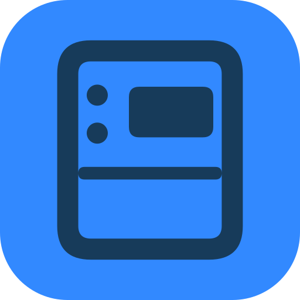</p>

# Foldlet

Open apps on your **Galaxy Z Flip3 cover screen**. Foldlet adds an app drawer, search, favorites, and navigation alongside Samsung’s native clock and widgets.

**[Download APK 0.10.3](https://github.com/luongwnv/Foldlet/releases/download/v0.10.3/Foldlet-0.10.3.apk)** · **0.10.3 beta** · Tested on **SM-F711B, Android 14 / One UI 6.1.1**.

[Foldlet Controls 1.1.0 (Optional)](https://github.com/luongwnv/Foldlet/releases/download/v0.10.3/Foldlet-Controls-1.1.0.apk) enables one-tap Wi-Fi and Bluetooth without a computer.

## Screenshots

Actual captures of the native Android interface running on a dedicated test emulator. The drawer runs at **512 × 260**, matching the Flip3 cover screen. The apps shown depend on what is installed on your phone.

<table align="center">
<thead><tr><th>App drawer</th><th>Search</th></tr></thead>
<tbody>
<tr><td valign="middle">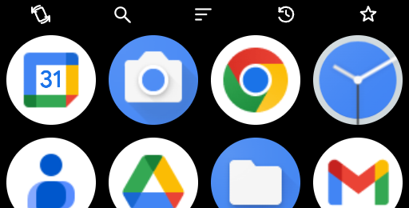</td><td valign="middle">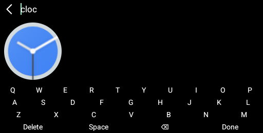</td></tr>
</tbody>
</table>

<p align="center">
  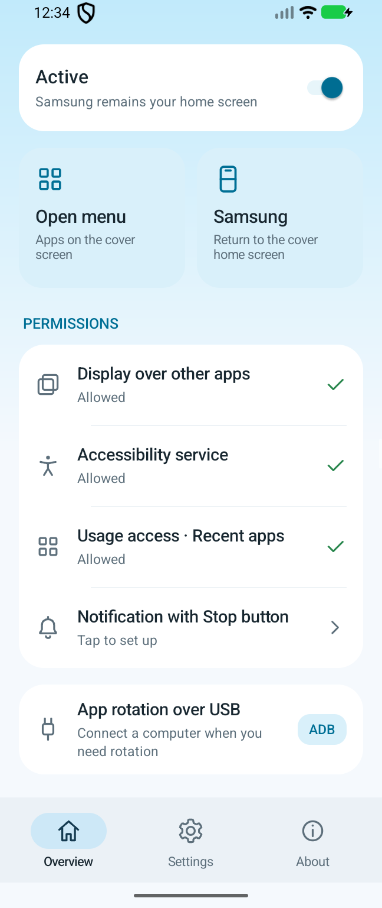
  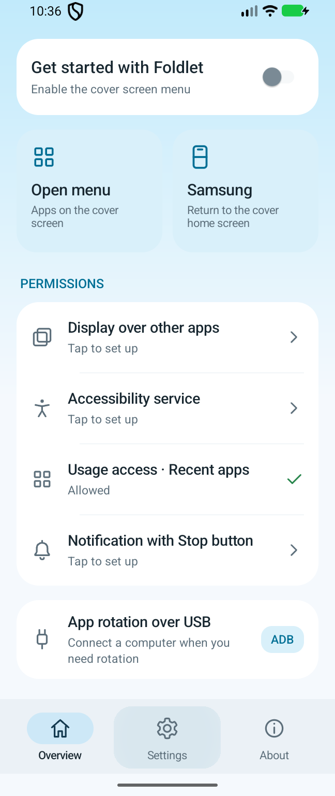
</p>

## Features

- Large icons, 4–6 columns, search, favorites, sorting, and hidden apps.
- A toolbar with adjustable size, top/left/right/bottom placement, and a hide option. It also hides when scrolling down.
- A configurable tap area on the **Samsung clock page** opens the drawer; swiping from the right edge opens navigation.
- Swipe down from the clock’s top edge for customizable One UI shortcuts, including Wi-Fi, Bluetooth, mobile data, hotspot, and 4G/5G settings. Widget pages keep Samsung controls.
- Tap Wi-Fi or Bluetooth to switch it with the optional Foldlet Controls helper; touch and hold to open system settings.
- Back, app drawer, Recent apps, and Samsung Home navigation while using an app on the cover screen.
- Recent apps from across your phone, including apps opened on the inner screen.
- English and Vietnamese following your system language; other languages fall back to English.
- An optional cover keyboard for text fields in other apps, with offline swipe typing (Beta).
- Optional sensor-driven Auto, portrait, and landscape rotation through a USB connection to your computer.

## Getting started

1. Download **Foldlet-0.10.3.apk** from [Releases](https://github.com/luongwnv/Foldlet/releases), open it on your phone, and allow installation from that source when Android asks.
2. Open **Foldlet** on the inner screen. In **Overview**, grant **Display over other apps** and enable the **Foldlet** service in Android’s **Accessibility** settings.
3. Grant **Usage access** to use Recent apps. Allow notifications if you want the service notification and its **Stop** button.
4. Turn on the Foldlet service, fold your phone, and wake the cover screen.

To update, install the new APK over your existing version and open Foldlet once. Versions signed with the same certificate can update without uninstalling the app.

For one-tap Wi-Fi and Bluetooth, install **Foldlet-Controls-1.1.0.apk** from the same release. It runs only when Foldlet requests a control, has no separate launcher screen, and needs no ADB connection after installation. Without Controls, touch and hold a tile to use One UI settings.

## Using Foldlet

**From the Samsung clock:** tap the configured touch area to open apps. Swipe inward from the right edge for navigation, or swipe down from the top edge for Shortcuts. Foldlet removes these touch areas on Samsung’s widget pages.

**In the app drawer:** tap an icon to open an app and swipe vertically to scroll. Use the toolbar to search, filter, or sort. Long-press an icon to favorite it, hide it, or choose its launch orientation. Swipe inward from either the left or right edge to return to Samsung Home.

**Inside an app:** swipe from the right edge toward the left to reveal the navigation bar.

<p align="center">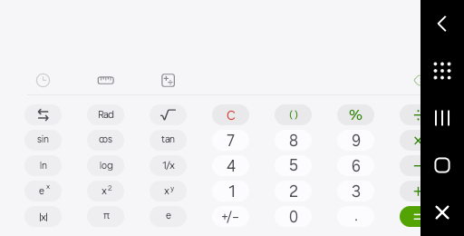</p>

Captured directly on a Galaxy Z Flip3. Each control below is cropped from the same screenshot, in top-to-bottom order.

<table align="center">
<thead><tr><th>Control</th><th>Action</th></tr></thead>
<tbody>
<tr><td valign="middle"> <strong>Back</strong></td><td valign="middle">Go back in the current app</td></tr>
<tr><td valign="middle"> <strong>Apps</strong></td><td valign="middle">Open the Foldlet app drawer</td></tr>
<tr><td valign="middle"> <strong>Recent apps</strong></td><td valign="middle">Open Recent apps</td></tr>
<tr><td valign="middle"> <strong>Home</strong></td><td valign="middle">Return to the Samsung clock</td></tr>
<tr><td valign="middle"> <strong>Hide</strong></td><td valign="middle">Hide the navigation bar</td></tr>
</tbody>
</table>

Long-press **Hide** to give Samsung control until the next screen wake.

### Recent apps and Close all

<p align="center">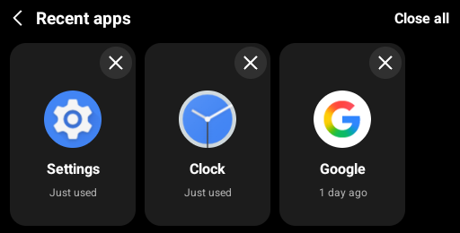</p>

Recent apps shows up to **30 apps used within the past 7 days**, based on Android’s usage history. Tap a card to reopen the app on the cover screen.

On the Galaxy Z Flip3, tap **×** at the top-right of a card to close its task through **Samsung Recent**. **Close all** runs Samsung's native Close all action. Foldlet keeps its own menu visible while Samsung handles the action underneath, then updates the cards. These actions close tasks like dismissing cards in Samsung Recent; they do not Force stop apps in Android Settings. Samsung's rules for locked tasks still apply.

While an app is closing, its **× becomes a spinning loading indicator** and repeated taps are blocked. Foldlet only dismisses the individual history card after Samsung accepts the Close action. If Samsung refuses or the task cannot be found, the card stays, × returns, and Foldlet reports the problem. **Hold ×** to remove only a history card, useful for an app whose task was already closed. A card appears again after you use the app. The list is usage history, so some entries may have no active system task.

Task closing requires **Android 14 or newer**, the existing Accessibility service, and the supported Samsung Recent interface. It runs on the phone without USB, root, Shizuku, or additional permission setup. If Foldlet cannot keep its menu visible, it leaves the task untouched and reports the problem. Other phone models and launcher versions have not been verified.

### Home touch area and Shortcuts

<p align="center">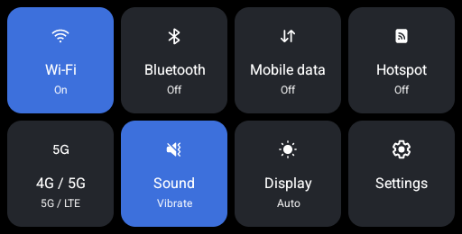</p>

Captured on a Galaxy Z Flip3 using its installed One UI icons.

Swipe down from the Samsung clock’s top edge to open the controls. Swipe up from the panel’s bottom edge to close it and return to Samsung Home.

In **Settings > Home touch area**, choose the rectangle’s width, height, horizontal position, and vertical position using the preview. You can disable tap-to-open or hide its small indicator. Swiping from the right edge still opens navigation.

<p align="center">
  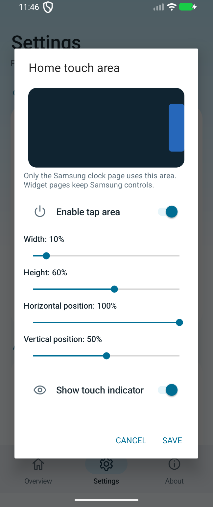
  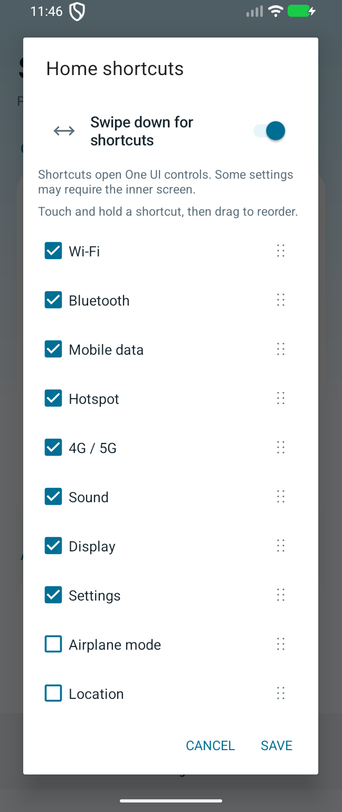
</p>

In **Settings > Home shortcuts**, enable or disable the top-edge swipe, select available system shortcuts, then touch and hold a shortcut and drag it to reorder.

On the cover panel, **tap Wi-Fi or Bluetooth to switch it** using Foldlet Controls. **Touch and hold** any tile for system settings. Sound switches between ringing and vibration; Display and Settings open their controls.

Blue indicates on; a dimmed tile indicates a change in progress. Hotspot, mobile data, sound, airplane mode, and location update from the device state. Each tile shows its state below the label; unavailable readings are marked explicitly. Network mode shows the configured preference when One UI exposes it, and Display shows automatic/manual brightness. The panel fills the cover screen and uses the installed Samsung icons when available.

Reading these states works on the phone without USB. Foldlet Controls 1.1.0 is needed for hotspot and configured network-mode readings.

**Mobile data and Hotspot** can switch on tap after the Samsung routine setup below. For 4G/5G, airplane mode, and location, touch and hold the tile to change it in system settings. If the OS cannot show a control on the cover screen, Foldlet offers **Open on phone**.

### Samsung routines for Mobile data and Hotspot (Optional)

Set this up once on the inner screen. Afterward, the cover-screen buttons work without USB, root, or Shizuku.

1. Open **Settings > Samsung controls** in Foldlet.
2. Tap **Add routine** under an On/Off action. Foldlet opens the ready-made preset directly in Samsung Routines+. If the module is missing, install it from the Galaxy Store page that opens, then tap **Add routine** again.
3. Samsung shows the routine for your review. Choose **Edit**, open **When routine ends > Set actions**, and turn off reverse actions. Save the routine. Samsung's import format does not preserve this setting, so it needs to be changed once for each preset.
4. Back in Foldlet, tap **Link**, allow access to that single routine widget, and select the matching saved routine.
5. Repeat for **Foldlet Data On**, **Foldlet Data Off**, **Foldlet Hotspot On**, and **Foldlet Hotspot Off**. Existing routines with these actions and reverse actions disabled can be linked directly.

<p align="center">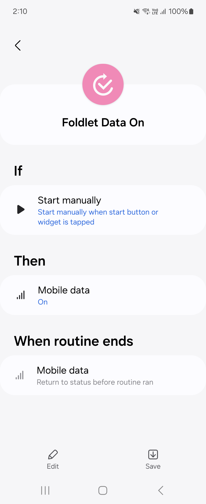</p>

The image above is captured from the Galaxy Z Flip3. Samsung requires confirmation for importing routines and allowing widget access; Foldlet does not add routines silently. Tap a cover-screen tile to apply its On or Off routine. Long-press still opens system settings. Unlinking in Foldlet removes the widget link; the saved routine remains in Samsung Modes and Routines.

Hotspot state detection requires **Foldlet Controls 1.1.0**. If a routine cannot change the setting, Foldlet reports it instead of showing a successful toggle. This integration has been checked on the Flip3's Android 14 / One UI 6.1.1 with Samsung Routines+; availability can differ on other Samsung versions.

### Customization

Open **Settings** to choose the column count, app labels, sorting, filters, and launch orientation. Under **Toolbar**, select **Top**, **Left**, **Right**, or **Bottom**, choose a size from 28 to 56 dp, or turn off **Show toolbar**. Search temporarily uses a horizontal bar so the input field remains readable. Long-pressing an app still shows its actions when the normal toolbar is hidden.

The preview uses the actual drawer and your installed app icons to reflect your selected layout.

### Cover keyboard and swipe typing

<p align="center">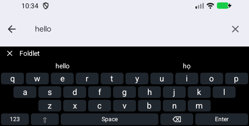</p>

- **Drawer search:** tap Search to use Foldlet’s compact keyboard. Use Done to hide it while keeping your results visible.
- **Other apps:** on Android 13 or newer, enable **Force cover keyboard** in Settings. Tap a text field on the cover screen to show the keyboard. An extra keyboard button in the navigation bar can reopen it. The close button hides it until another input session starts.
- **Swipe typing (Beta):** enable it in Settings, then slide across letters. Foldlet enters the best match and offers alternatives you can tap to correct the word. The vocabulary contains basic English/Vietnamese words and, in drawer search, installed app names. It is an experimental offline recognizer with a limited vocabulary.
- Tap **123** for symbols, Shift for capitals, or hold a vowel for accented characters. Hold Backspace to keep deleting.

The cover keyboard writes only to the active cover-screen editor. It closes when the editor changes, the phone locks, or the screen turns off. Password fields use tap input without swipe suggestions. Some apps do not expose a compatible input connection; tap the field again or use that app’s own input controls in those cases.

## Permissions

Permission shortcuts are available in **Overview**. You can revoke permissions in Android Settings.

<table align="center">
<thead><tr><th>Permission</th><th>Purpose</th></tr></thead>
<tbody>
<tr><td valign="middle">Display over other apps</td><td valign="middle">Show the drawer and navigation bar on the cover screen</td></tr>
<tr><td valign="middle">Network state</td><td valign="middle">Read the mobile-data switch state; granted automatically by Android</td></tr>
<tr><td valign="middle">Accessibility</td><td valign="middle">Distinguish Samsung’s clock and widget pages, handle Back, close tasks through Samsung Recent when requested, and send keyboard input to the focused cover-screen editor when enabled</td></tr>
<tr><td valign="middle">Usage access (Optional)</td><td valign="middle">Show Recent apps and help identify an app’s launcher page when handling Back</td></tr>
<tr><td valign="middle">Notifications (Optional)</td><td valign="middle">Show the service status and Stop button</td></tr>
<tr><td valign="middle">Notification access (Optional)</td><td valign="middle">Support notification and media features when used</td></tr>
<tr><td valign="middle">Samsung routine widget access (Optional)</td><td valign="middle">Run the specific routine widgets you link for Mobile data and Hotspot; Android asks for permission when linking</td></tr>
</tbody>
</table>

Recent-app data is read on your device, is not sent to a server, and is not saved as a separate usage history. Foldlet keeps dismissal timestamps so closed cards stay hidden until their apps are used again. Input to other apps is write-only: existing field contents are not read or recorded. Swipe traces and suggestions stay in memory and are discarded when the keyboard closes. While closing tasks, Foldlet holds a temporary rendering of its own menu in memory and discards it afterward; it does not capture other apps or save screenshots. Its network connection is used only for the ADB rotation bridge on localhost.

**Foldlet Controls (Optional)** uses Wi-Fi state/change and legacy Bluetooth permissions to switch those two radios and read Wi-Fi, Bluetooth, hotspot, and configured network-mode state. It does not scan networks or devices, read their names, access location, or connect to the internet. Only Foldlet signed with the matching certificate can call its service. The helper uses Android’s older compatibility APIs; Foldlet itself continues to target modern Android.

## Optional USB rotation

Opening apps, Back, Home, and Recent apps work independently. **Forced rotation** on the Flip3 requires an active USB connection to a computer. No root or Shizuku is needed.

On a computer with Python 3 and ADB installed, download this repository and enable **USB debugging** on your phone. From the project folder, run:

```sh
adb devices
python3 scripts/adb_rotation_bridge.py --serial DEVICE_SERIAL
```

Replace `DEVICE_SERIAL` with the device ID shown by `adb devices`, authorize the USB connection on your phone, and keep the process running. After updating Foldlet, restart this script so the helper uses the installed version.

In **Settings > App orientation**, or the drawer's rotation menu, choose:

- **Auto (sensor):** rotate the cover-screen app as you turn the folded phone. Hold the cover upright; when the phone lies flat, Foldlet keeps the last direction. A short settling delay prevents small movements from repeatedly rotating the app.
- **Landscape** or **Portrait:** keep the cover app in that direction.
- **App default:** let the app and Samsung choose their normal orientation. This does not force sensor rotation.

An app's own saved orientation takes priority. Long-press its drawer icon, open **App orientation**, and select **Use general setting** to follow your global choice, or **Auto (sensor)** for that app.

Sensor rotation runs while using an app on the cover screen. Returning to Samsung Home, turning the cover screen off, unfolding, locking the phone, or stopping Foldlet stops it and restores the previous cover rotation policy. The inner display and your system auto-rotate switch keep their settings. Stopping the computer helper or losing USB also restores the previous policy. Apps can still open when the helper is unavailable.

## Troubleshooting

- **Tapping home does not open the drawer:** return to the Samsung clock, check **Settings > Home touch area**, and tap inside the configured region. Check the service switch, Accessibility, and Display over other apps permissions. After an update, open Foldlet on the inner screen once.
- **Recent apps is empty:** grant Usage access and open another app. After Close all, use an app again for its card to reappear.
- **Back does not work in an app:** some apps do not expose a usable navigation path on the cover screen. Use the app’s own back control when Foldlet prompts you.
- **Rotation does not change:** check USB and the running helper; restart the script after an update. Choose **Auto (sensor)** rather than **App default**, check per-app overrides, and hold the cover upright while turning it.

This beta focuses on the **Galaxy Z Flip3**; other models have not been verified. Samsung controls its own clock, widgets, and date formatting. Some apps and protected Android screens may restrict cover-screen operation.
